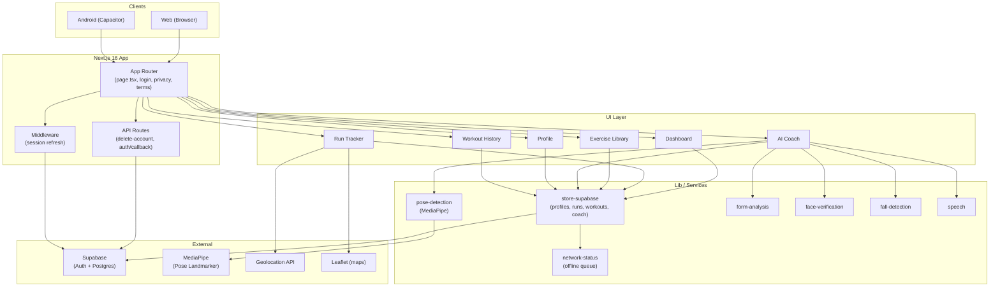
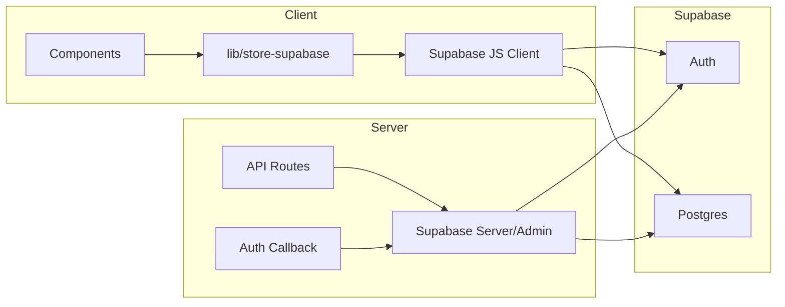
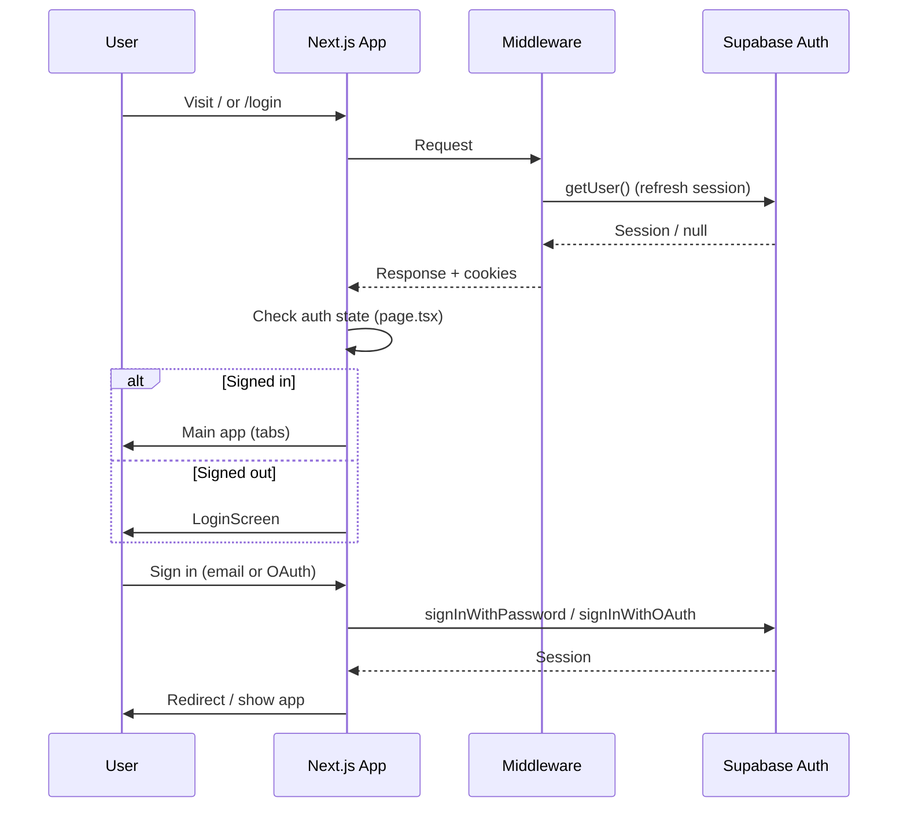

# FitTrack Go — Architecture

High-level architecture for the FitTrack Go app (Next.js, Supabase, MediaPipe, Capacitor).

---

## System overview



---

## Data flow



---

## Auth flow



---

## Main features and dependencies

| Feature | Components | Lib / APIs | Data (Supabase) |
|--------|------------|------------|------------------|
| **Dashboard** | `Dashboard`, `BottomNav` | `store-supabase` (streak, stats) | profiles, runs, workouts, coach_sessions |
| **Run tracker** | `RunTracker`, `RunMap` | `store-supabase` (`addRun`), Geolocation, Leaflet | runs |
| **Exercise library** | `ExerciseLibrary` | `store-supabase` (workouts), `data/exercises.json` | workouts |
| **AI Coach** | `AICoach`, `FaceEnrollCapture` | `pose-detection`, `form-analysis`, `face-verification`, `fall-detection`, `speech`, `alarm-sound`, `center-check`, `store-supabase` | coach_sessions |
| **Profile** | `ProfileScreen` | `store-supabase`, Supabase Auth | profiles, delete-account API |
| **History** | `WorkoutHistory` | `store-supabase` (`getWorkouts`, `getRuns`, `getCoachSessions`) | workouts, runs, coach_sessions |

---

## Tech stack summary

| Layer | Tech |
|-------|------|
| **Frontend** | Next.js 16 (App Router), React 19, TypeScript, Tailwind, Radix UI |
| **Auth & DB** | Supabase (Auth: email/password + OAuth, Postgres) |
| **Pose / form** | MediaPipe Pose Landmarker (browser), custom form-analysis |
| **Maps** | Leaflet |
| **Mobile** | Capacitor (Android), static export to `out/` |
| **Network** | Offline queue in `network-status.ts` for failed writes |

---

## Directory layout (relevant)

```
app/                 # Routes & entry
  page.tsx           # Main SPA (splash → login → app with tabs)
  layout.tsx
  auth/callback/     # OAuth callback
  api/delete-account/
components/          # UI (dashboard, run-tracker, ai-coach, profile, …)
lib/                 # Core logic
  store-supabase.ts  # All Supabase read/write (profiles, runs, workouts, coach)
  pose-detection.ts  # MediaPipe wrapper
  form-analysis.ts   # Rep counting & form scoring
  face-verification.ts
  fall-detection.ts
  speech.ts
  network-status.ts
  supabase/          # client, server, middleware
data/                # Static (exercises.json, achievements, faq)
android/             # Capacitor Android project (webDir: out)
```

---

## Rendering the diagrams

- **In Cursor / VS Code:** Use a Mermaid preview extension.
- **On GitHub:** Paste the `mermaid` blocks into a `.md` file; GitHub renders them.
- **Online:** Copy the contents of a `mermaid` block into [mermaid.live](https://mermaid.live) to export as PNG/SVG.
