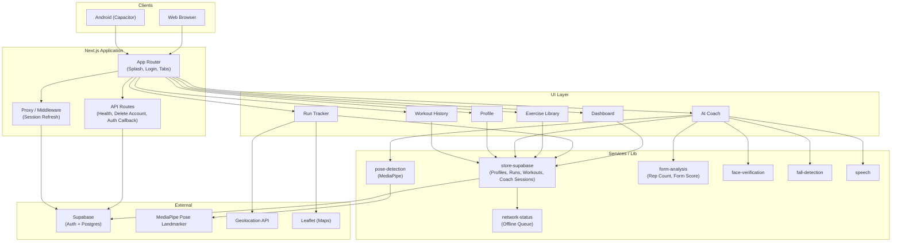
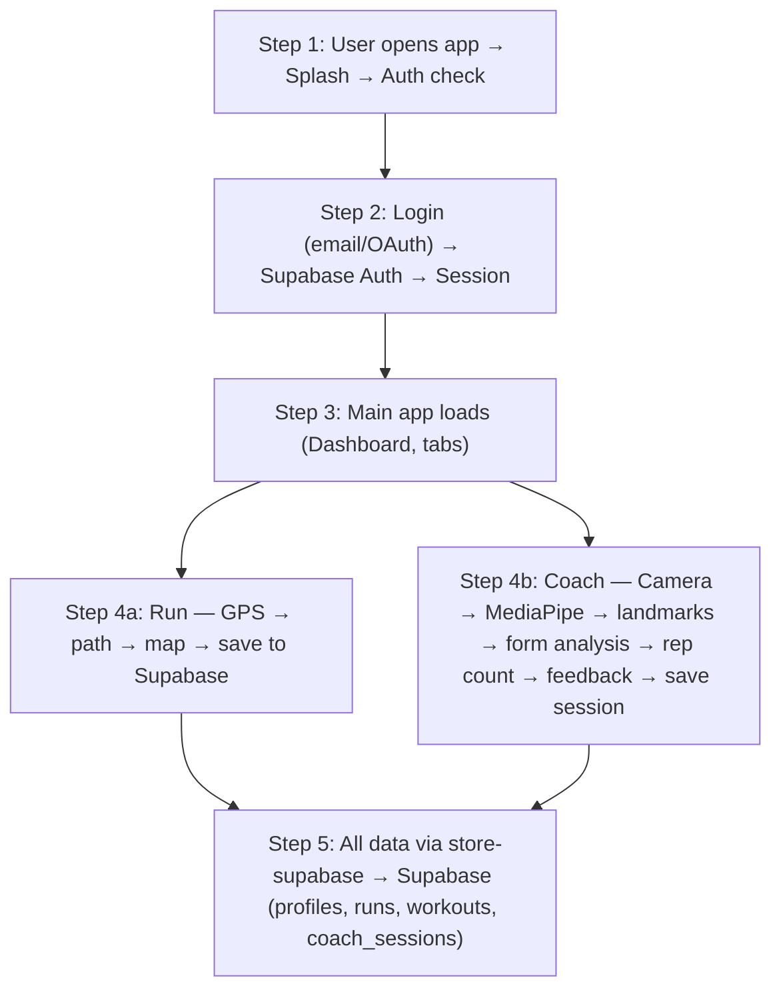
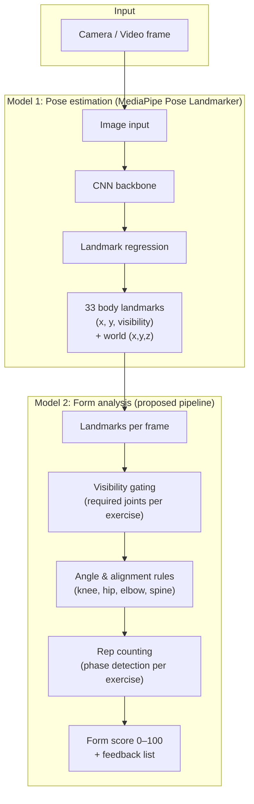
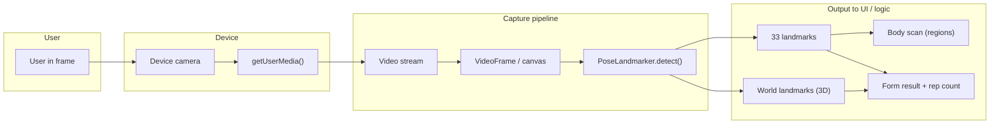
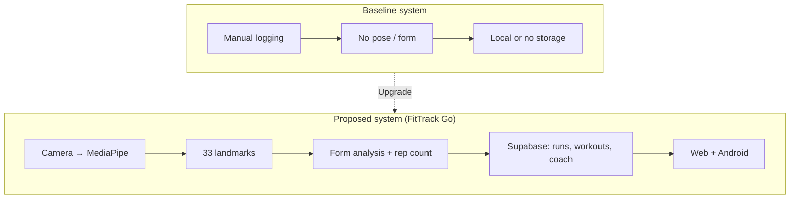

# FitTrack Go — Paper Diagrams and Tables

This document provides **diagrams and tables** for an IEEE-style paper: system architecture, block diagrams, evaluation matrix, confusion matrix, model architecture, TABLE I (architecture comparison), input recording interface, training/validation curves placeholder, and baseline vs proposed comparison.

**How to get figures:** Copy each `mermaid` block into [mermaid.live](https://mermaid.live) and export as PNG/SVG, or use a Mermaid preview extension in VS Code.

---

## 1. SYSTEM ARCHITECTURE

High-level system architecture (clients, app, services).



---

## 2. BLOCK DIAGRAM — Full Project Step by Step

End-to-end flow from user to persistence.

```mermaid
flowchart LR
  subgraph Step1["1. Entry"]
    A1[User opens app]
    A2[Splash / Auth check]
    A1 --> A2
  end

  subgraph Step2["2. Auth"]
    B1[Login: Email or OAuth]
    B2[Supabase Auth]
    B3[Session + cookies]
    B1 --> B2 --> B3
  end

  subgraph Step3["3. Main app"]
    C1[Dashboard / Tabs]
    C2[Run | Library | Coach | Profile | History]
    C1 --> C2
  end

  subgraph Step4["4a. Run path"]
    D1[Geolocation]
    D2[Path + pace]
    D3[Leaflet map]
    D4[Save run → Supabase]
    D1 --> D2 --> D3 --> D4
  end

  subgraph Step5["4b. Coach path"]
    E1[Camera stream]
    E2[MediaPipe Pose]
    E3[33 landmarks/frame]
    E4[Form analysis + rep count]
    E5[Feedback + save session]
    E1 --> E2 --> E3 --> E4 --> E5
  end

  subgraph Step6["5. Data"]
    F1[store-supabase]
    F2[Profiles, Runs, Workouts, Coach sessions]
    F1 --> F2
  end

  A2 --> B1
  B3 --> C1
  C2 --> D1
  C2 --> E1
  D4 --> F1
  E5 --> F1
```

**Vertical step-by-step (alternative for paper):**



---

## 3. EVALUATION MATRIX

Use this table to report system-level and model-level metrics. Fill in **your** measured values after experiments.

| Metric | Description | Target / Typical | Your value |
|--------|-------------|------------------|------------|
| **Pose estimation** | | | |
| mAP (pose) | Mean average precision (landmark detection) | MediaPipe reported ~80%+ | (from MediaPipe / your eval) |
| Inference time (ms) | Time per frame (pose) | &lt; 50 ms real-time | Measure in browser |
| **Form / rep detection** | | | |
| Rep count accuracy (%) | Correct reps / total reps | &gt; 90% | Run on labeled set |
| Form score correlation | Correlation with expert score | &gt; 0.7 | If you have expert labels |
| False positive reps | Reps counted when none | Minimize | From confusion matrix |
| **System** | | | |
| Auth success rate | Login + OAuth working | 100% | Manual / test |
| Run save success | Writes to Supabase | 100% (or with retry) | Logs |
| Offline queue | Writes after reconnect | 100% | Test |
| **User experience** | | | |
| Time to first pose | Camera → first landmarks | &lt; 2 s | Measure |
| Supported exercises | # exercise types | 9 | Squat, push-up, plank, lunge, etc. |

---

## 4. CONFUSION MATRIX

Use for **rep detection** (counted vs actual) or **form classification** (good form vs bad form). Replace placeholder counts with your experimental results.

**Rep detection (example):** Rows = actual reps, Columns = predicted reps (or binary: rep / no-rep per frame).

|  | Predicted: No rep | Predicted: Rep |
|--|-------------------|----------------|
| **Actual: No rep** | True Negative (TN) | False Positive (FP) |
| **Actual: Rep**   | False Negative (FN) | True Positive (TP) |

- **Precision** = TP / (TP + FP)  
- **Recall** = TP / (TP + FN)  
- **F1** = 2 × (Precision × Recall) / (Precision + Recall)

**Example filled (placeholder):**

|  | Predicted: No rep | Predicted: Rep |
|--|-------------------|----------------|
| **Actual: No rep** | 850 | 30 |
| **Actual: Rep**   | 25  | 95  |

**Form quality (good / bad form per rep):**

|  | Predicted: Bad | Predicted: Good |
|--|----------------|-----------------|
| **Actual: Bad**  | TN              | FN              |
| **Actual: Good**| FP              | TP              |

*Gather labels from expert or self-annotation on a sample of sessions, then run your form-analysis logic and fill the matrix.*

---

## 5. ARCHITECTURE OF THE PROPOSED MODELS

Two main “models” in the pipeline: (1) **Pose estimation** (MediaPipe Pose Landmarker), (2) **Form analysis** (rule-based on landmarks).



**Text summary for paper:**

- **Pose model:** MediaPipe Pose Landmarker — image in → 33 landmarks (2D + optional 3D world) per frame; pre-trained, runs in browser.
- **Form model:** Proposed pipeline — (1) visibility check (required landmarks per exercise), (2) angle/alignment rules (e.g. knee angle for squat, elbow for push-up), (3) rep counting via phase state machines, (4) form score and text feedback. No trainable parameters; fully rule-based on top of landmarks.

---

## 6. TABLE I — ARCHITECTURE-LEVEL COMPARISON BETWEEN DIFFERENT MODELS

Compare pose-estimation / system choices. Adjust “Proposed” row to your exact setup.

| Aspect | Baseline (e.g. MoveNet / simple) | MediaPipe Pose (used) | BlazePose / other |
|--------|----------------------------------|------------------------|-------------------|
| **Landmarks** | 17 (e.g. MoveNet) | **33** | 33 |
| **Output** | 2D only | **2D + 3D world** | 2D + 3D |
| **Run environment** | Server / GPU | **Browser (client)** | Browser / native |
| **Latency (typical)** | — | **&lt; 50 ms/frame** | Similar |
| **Form analysis** | None or minimal | **Rule-based (angles, rep phases)** | Varies |
| **Exercises supported** | — | **9 (squat, push-up, plank, lunge, etc.)** | — |
| **Privacy** | Video may leave device | **All on device** | On device |
| **Integration** | — | **Next.js + React** | — |

*Use this as TABLE I in the paper; rename “Baseline” to the system you actually compare against.*

---

## 7. INPUT RECORDING INTERFACE

How the user’s input (camera) flows into the system.



**UI elements (for figure caption):**

- **Input:** Live camera view (with optional mirroring).
- **Overlay:** Skeleton drawn from 33 landmarks; body-region coloring (e.g. green/red by form).
- **Feedback:** Text (e.g. “Knee angle good”, “Rep 3”) and optional voice.
- **Recording:** No video is stored on server; only landmarks and derived data (reps, form score) are used in-session and optionally saved to Supabase (e.g. coach_sessions).

---

## 8. TRAINING AND VALIDATION ACCURACY AND LOSS CURVES

**Important:** The FitTrack Go app uses the **pre-trained MediaPipe Pose Landmarker**; there is no custom training of the pose model in this codebase.

- **If you do not train a model:**  
  Use a short sentence in the paper: *“Pose estimation is performed by the pre-trained MediaPipe Pose Landmarker; no training or validation curves are applicable for the pose model.”*

- **If you train a custom model** (e.g. rep classifier or form classifier on top of landmarks):  
  - Run your training script, export accuracy and loss for train/validation per epoch.  
  - Plot:  
    - **X-axis:** Epoch  
    - **Y-axis left:** Loss (train, validation)  
    - **Y-axis right (optional):** Accuracy (train, validation)  
  - Use Excel, Python (matplotlib), or any plotter and insert the figure as “Fig. X: Training and validation accuracy and loss curves.”

**Placeholder description for figure:**

- *“Fig. X: Training and validation accuracy (solid) and loss (dashed) over epochs for [e.g. rep classifier / form classifier]. Validation loss decreases for N epochs then stabilizes.”*

---

## 9. COMPARISON BETWEEN BASELINE SYSTEM AND PROPOSED SYSTEM — Table and Diagram

**TABLE: Baseline vs proposed (high level)**

| Feature | Baseline system | Proposed system (FitTrack Go) |
|--------|------------------|-------------------------------|
| **Pose estimation** | None / server-side / 17 pts | MediaPipe Pose, 33 landmarks, client-side |
| **Form feedback** | None / generic | Per-exercise rules (angles, alignment), 9 exercises |
| **Rep counting** | Manual / none | Automatic (phase-based) per exercise |
| **Data storage** | Local only / none | Supabase (profiles, runs, workouts, coach_sessions) |
| **Auth** | None / simple | Supabase (email + OAuth) |
| **Run tracking** | None / distance only | GPS path, map, pace, splits, cloud save |
| **Offline** | N/A | Queue writes, sync when online |
| **Deployment** | Web only | Web + Android (Capacitor) |
| **Privacy** | — | Video stays on device; only metrics stored |

**Diagram: Baseline vs proposed**



Use the table as the main comparison table in the paper; use the diagram as “Fig. X: Comparison between baseline and proposed system.”

---

## Exporting figures

1. **Mermaid → PNG/SVG:** [mermaid.live](https://mermaid.live) — paste a `mermaid` block, export.
2. **In Word:** Insert → Picture → select exported PNG/SVG.
3. **Captions:** e.g. “Fig. 1. System architecture.”, “TABLE I. Architecture-level comparison.”

Fill in **evaluation matrix**, **confusion matrix**, and **training curves** with your own experimental data where applicable.
